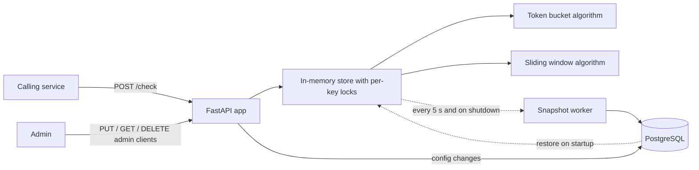

# Token Bucket Rate Limiter Service

A standalone HTTP service that other services call to ask: "is this client allowed to make a request right now?" It supports two algorithms (token bucket and sliding window) selectable per client, keeps its state across restarts, and stays correct under concurrent load.

## Features

- `POST /check` returns ALLOW (200) or DENY (429) for a client key
- Per-client limits (rate, burst) and algorithm, set through an admin API
- State survives restarts (periodic snapshots to PostgreSQL)
- Race-condition safe: concurrent requests for the same key can never double-spend a token
- Standard rate-limit headers on every `/check` response
- Load-tested at 1,500+ requests/second with automatic correctness checks

## Architecture



The hot path (`/check`) never touches the database: buckets and windows live in memory, and a background worker saves them to PostgreSQL every 5 seconds and once more on graceful shutdown. Client configs are stored in PostgreSQL and cached in memory.

## API

### `POST /check`

```bash
curl -i -X POST http://127.0.0.1:8000/check \
  -H "Content-Type: application/json" -d '{"client_key": "demo"}'
```

Returns **200** with `"decision": "ALLOW"` or **429** with `"decision": "DENY"`:

```json
{"decision": "ALLOW", "remaining": 9, "retry_after": 0.0, "reset_after": 0.2}
```

Headers on every response:

| Header | Meaning |
|---|---|
| `X-RateLimit-Limit` | Max requests allowed (the client's burst) |
| `X-RateLimit-Remaining` | Requests left right now |
| `X-RateLimit-Reset` | Unix timestamp (seconds) when the limit is fully restored |
| `Retry-After` | Seconds to wait before retrying (429 responses only) |

Clients without a custom config get the defaults: token bucket, 5 requests/second, burst of 10.

### Admin endpoints

| Method | Path | Purpose |
|---|---|---|
| `PUT` | `/admin/clients/{client_key}` | Create or update a client's config |
| `GET` | `/admin/clients/{client_key}` | Read a client's config (404 if default) |
| `DELETE` | `/admin/clients/{client_key}` | Remove a client's custom config |
| `GET` | `/health` | Health check |

```bash
curl -X PUT http://127.0.0.1:8000/admin/clients/demo \
  -H "Content-Type: application/json" \
  -d '{"rate": 5, "burst": 10, "algorithm": "sliding_window"}'
```

## Algorithms

- **Token bucket** (`token_bucket`): a bucket holds up to `burst` tokens and refills at `rate` tokens/second (lazily, computed on each request). Each request spends one token. Allows bursts, then a steady rate.
- **Sliding window** (`sliding_window`): allows at most `burst` requests in any window of `burst / rate` seconds, by remembering the timestamp of each allowed request. Exact, with no boundary effect like a fixed-window counter. Denied requests are not recorded.

## Design decisions

- **In-memory hot path with periodic snapshots** instead of a database write per request: fast, at the cost of losing up to 5 seconds of state on a hard crash.
- **Pure algorithm functions** (state in, new state out, current time passed in): easy to test without sleeping.
- **Per-key locks** make read-compute-write atomic per client without blocking other clients; a short guard lock protects the shared dictionaries and is never held during a database call.
- **Wall-clock timestamps** are stored so that downtime counts as refill time after a restart.
- **DENY is HTTP 429**; both algorithms return the same result shape and headers.
- **Single process (v1):** locks and state are per-process, so run one uvicorn worker.
**Idle-client eviction:** a background pass removes a client's state once it is identical to a new client's state (bucket fully refilled, or window empty), so eviction never changes a decision; striped locks avoid per-client lock objects.

## Project structure

```
app/
  algorithms/    token_bucket.py, sliding_window.py (pure functions)
  main.py        HTTP routes and startup/shutdown
  store.py       in-memory state, locking, algorithm dispatch
  snapshots.py   background snapshot worker and restore
  client_config.py, db.py, config.py, schemas.py, headers.py
tests/           unit, API, concurrency, and snapshot tests
loadtest/        Locust load test with correctness checks
```

## Run it locally

```bash
python -m venv venv
source venv/Scripts/activate        # Windows Git Bash; on macOS/Linux: source venv/bin/activate
pip install -r requirements.txt
cp .env.example .env                # then put your PostgreSQL password in .env
```

Create two PostgreSQL databases, `ratelimiter` and `ratelimiter_test`, then:

```bash
uvicorn app.main:app                # one process only
```

Interactive API docs: http://127.0.0.1:8000/docs

## Tests

```bash
pytest -v
```

35 tests cover the algorithms, the HTTP API, concurrent access (threads with an artificially widened race window), snapshot save/restore, and the headers. Tests run against the separate `ratelimiter_test` database.

## Load test

The load test checks correctness, not just speed. It hammers one token-bucket client and one sliding-window client (the hardest case: many simultaneous requests for the same key) plus 1,000 spread-out keys, then verifies that the number of allowed requests stays inside mathematical bounds:

- **Token bucket:** allowed <= burst + rate x elapsed (a double-spent token would exceed this)
- **Sliding window:** allowed <= limit per window-length slice of time
- Every response must carry the rate-limit headers, and throughput must reach 500 requests/second

```bash
pip install -r requirements-loadtest.txt
uvicorn app.main:app --no-access-log --log-level warning       # terminal 1
locust -f loadtest/locustfile.py --headless -u 60 -r 60 -t 30s --host http://127.0.0.1:8000   # terminal 2
```

### Results (28 Oct 2026)

60 simulated users for 30 seconds on a Windows laptop. The load generator and the server shared the machine, and CPU stayed above 90%, so these numbers are conservative.

```
token bucket     allowed=  1579  denied=  16372  expected 1556..1587  PASS
sliding window   allowed=  1500  denied=  16491  expected 1300..1500  PASS
throughput       1,509 requests/s (target >= 500)  PASS
failures         0  PASS
```

Response times: median 23 ms, 95th percentile 68 ms, 99th percentile 95 ms.

I also validated the test itself: removing the per-key lock (with a widened race window) made the token bucket check fail, as it should.

## Known limitations

- Up to 5 seconds of state can be lost on a hard crash (graceful shutdown loses nothing)
- Admin endpoints have no authentication
- Single process only; multiple instances would each have their own state
- Sliding-window memory and per-request work grow with `burst`

## Roadmap

- Distributed mode: several limiter instances sharing state
- Live dashboard of request and deny rates per client