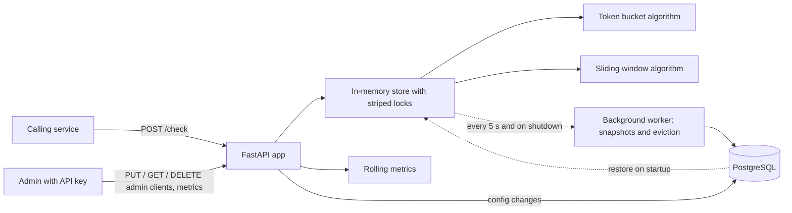

# Token Bucket Rate Limiter Service

A standalone HTTP service that other services call to ask: "is this client allowed to make a request right now?" It supports two algorithms (token bucket and sliding window) selectable per client, keeps its state across restarts, and stays correct under concurrent load.

## Features

- `POST /check` returns ALLOW (200) or DENY (429) for a client key, with an optional request `cost`
- Per-client limits (rate, burst) and algorithm, set through an admin API protected by an API key
- State survives restarts (periodic snapshots to PostgreSQL)
- Race-condition safe: concurrent requests for the same key can never double-spend a token
- Standard rate-limit headers on every `/check` response
- Idle clients are evicted from memory and the database without ever changing a decision
- Live dashboard at `/dashboard` with per-client request and deny rates
- Runs with one command using Docker Compose
- Load-tested above 500 requests/second with automatic correctness checks

## Architecture



The hot path (`/check`) never touches the database: buckets and windows live in memory, and a background worker saves them to PostgreSQL every 5 seconds and once more on graceful shutdown. The same worker evicts idle clients every 60 seconds. Client configs are stored in PostgreSQL and cached in memory.

## API

### `POST /check`

```bash
curl -i -X POST http://127.0.0.1:8000/check \
  -H "Content-Type: application/json" -d '{"client_key": "demo", "cost": 1}'
```

`cost` is optional (default 1) and lets one request spend several tokens. A cost greater than the client's burst can never be allowed, so it returns **422**.

Returns **200** with `"decision": "ALLOW"` or **429** with `"decision": "DENY"`:

```json
{"decision": "ALLOW", "remaining": 9, "retry_after": 0.0, "reset_after": 0.2}
```

Headers on every response:

| Header | Meaning |
|---|---|
| `X-RateLimit-Limit` | Max requests allowed (the client's burst) |
| `X-RateLimit-Remaining` | Requests left right now |
| `X-RateLimit-Reset` | Unix timestamp (seconds) when the limit is fully restored |
| `Retry-After` | Seconds to wait before retrying (429 responses only) |

Clients without a custom config get the defaults: token bucket, 5 requests/second, burst of 10.

### Open endpoints (no key needed)

| Method | Path | Purpose |
|---|---|---|
| `POST` | `/check` | The rate-limit decision |
| `GET` | `/health` | Health check |
| `GET` | `/dashboard` | The dashboard page (it holds no data; its data endpoint needs the key) |

### Admin endpoints (require the `X-API-Key` header)

| Method | Path | Purpose |
|---|---|---|
| `PUT` | `/admin/clients/{client_key}` | Create or update a client's config |
| `GET` | `/admin/clients/{client_key}` | Read a client's config (404 if default) |
| `DELETE` | `/admin/clients/{client_key}` | Remove a client's custom config |
| `GET` | `/admin/metrics` | Rolling per-client traffic numbers for the last 60 seconds |

```bash
curl -X PUT http://127.0.0.1:8000/admin/clients/demo \
  -H "X-API-Key: $ADMIN_API_KEY" \
  -H "Content-Type: application/json" \
  -d '{"rate": 5, "burst": 10, "algorithm": "sliding_window"}'
```

## Algorithms

- **Token bucket** (`token_bucket`): a bucket holds up to `burst` tokens and refills at `rate` tokens/second (lazily, computed on each request). Each request spends `cost` tokens (default 1). Allows bursts, then a steady rate.
- **Sliding window** (`sliding_window`): allows at most `burst` requests in any window of `burst / rate` seconds, by remembering the timestamp of each allowed request. Exact, with no boundary effect like a fixed-window counter. Denied requests are not recorded.

## Authentication

The admin endpoints (`/admin/...`) require a secret key in the `X-API-Key` header. Without a valid key they return **401**.

- Generate a key: `python -c "import secrets; print(secrets.token_urlsafe(32))"`
- Put it in `.env` as `ADMIN_API_KEY=...` (minimum 16 characters)
- The service **refuses to start** without a key, so it can never run with an open admin API by accident
- Keys are compared in constant time, and a missing key and a wrong key get the same response
- In the interactive docs at `/docs`, use the **Authorize** button to enter the key

`/check`, `/health` and the dashboard page itself stay open, because other services call them.

## Dashboard

Open `/dashboard`, paste the admin API key and click **Use key**. The page refreshes every second and shows, for the busiest clients: requests per second and denied requests per second over the last 10 seconds, allowed and denied totals over the last 60 seconds, and a deny-rate bar.

The key is kept in the browser tab's `sessionStorage` (cleared when the tab closes) and is sent as a header, never in the URL. Client keys are shown with `textContent`, never as HTML, because they are untrusted text.

## Run with Docker

The quickest way: Docker Compose starts the service and its PostgreSQL database together.

```bash
cp .env.example .env     # then fill in ADMIN_API_KEY and POSTGRES_PASSWORD
docker compose up --build
```

The service is then available at http://127.0.0.1:8080 (docs at `/docs`, dashboard at `/dashboard`).

- Stop it with `Ctrl+C` or `docker compose stop`: the service shuts down gracefully and saves its state first
- Data lives in the `pgdata` Docker volume, so it survives `docker compose down`; use `docker compose down -v` to delete it
- Config comes from environment variables; nothing secret is baked into the image (`.env` is excluded from the build)
- The container runs as a non-root user with a single uvicorn worker and a built-in health check

## Run locally (without Docker)

```bash
python -m venv venv
source venv/Scripts/activate        # Windows Git Bash; on macOS/Linux: source venv/bin/activate
pip install -r requirements-dev.txt
cp .env.example .env                # then fill in DATABASE_URL, TEST_DATABASE_URL and ADMIN_API_KEY
```

Create two PostgreSQL databases, `ratelimiter` and `ratelimiter_test`, then:

```bash
uvicorn app.main:app                # one process only
```

Interactive API docs: http://127.0.0.1:8000/docs

## Tests

```bash
pytest -v
```

64 tests cover the algorithms, the HTTP API, authentication, concurrent access (threads with an artificially widened race window), snapshot save/restore, eviction, request cost, the headers, and the metrics. Tests run against the separate `ratelimiter_test` database.

## Design decisions

- **In-memory hot path with periodic snapshots** instead of a database write per request: fast, at the cost of losing up to 5 seconds of state on a hard crash.
- **Pure algorithm functions** (state in, new state out, current time passed in): easy to test without sleeping.
- **Striped locks:** a fixed pool of 256 locks, chosen by a hash of the client key, makes read-compute-write atomic per client without per-client lock objects to leak. A short guard lock protects the shared dictionaries and is never held during a database call.
- **Idle-client eviction:** a background pass removes a client's state once it is identical to a new client's state (bucket fully refilled, or window empty), so eviction never changes a decision. It uses compare-and-delete, so state updated mid-sweep is skipped.
- **Wall-clock timestamps** are stored so that downtime counts as refill time after a restart.
- **DENY is HTTP 429**; both algorithms return the same result shape and headers.
- **Fail-closed admin key:** no default key, and the service will not start without one.
- **Graceful shutdown in containers:** uvicorn runs as the container's main process (exec-form `CMD`), so Docker's `SIGTERM` triggers the final snapshot.
- **Single process:** locks and state are per-process, so run one uvicorn worker.

## Project structure

```
app/
  algorithms/    token_bucket.py, sliding_window.py, idle.py (pure functions)
  main.py        HTTP routes and startup/shutdown
  store.py       in-memory state, striped locking, algorithm dispatch, eviction
  snapshots.py   background worker: snapshots, restore, eviction
  auth.py        admin API key check
  metrics.py     rolling per-client traffic counters
  errors.py, client_config.py, db.py, config.py, schemas.py, headers.py
  static/        dashboard.html
tests/           unit, API, concurrency, snapshot, eviction, auth and dashboard tests
loadtest/        Locust load test with correctness checks
Dockerfile, docker-compose.yml, .dockerignore
requirements.txt (runtime), requirements-dev.txt (tests), requirements-loadtest.txt
```

## Load test

The load test checks correctness, not just speed. It hammers one token-bucket client and one sliding-window client (the hardest case: many simultaneous requests for the same key) plus 1,000 spread-out keys, then verifies that the number of allowed requests stays inside mathematical bounds:

- **Token bucket:** allowed <= burst + rate x elapsed (a double-spent token would exceed this)
- **Sliding window:** allowed <= limit per window-length slice of time
- Every response must carry the rate-limit headers, and throughput must reach 500 requests/second

The script reads `ADMIN_API_KEY` from the environment or from `.env` (run it from the project root).

```bash
pip install -r requirements-loadtest.txt
uvicorn app.main:app --no-access-log --log-level warning       # terminal 1
locust -f loadtest/locustfile.py --headless -u 60 -r 60 -t 30s --host http://127.0.0.1:8000   # terminal 2
```

### Results

60 simulated users on a Windows laptop. The load generator and the server shared the machine, and CPU stayed above 90%, so these numbers are conservative.

**28 Oct 2026, 30 seconds (v1.0.0):**

```
token bucket     allowed=  1579  denied=  16372  expected 1556..1587  PASS
sliding window   allowed=  1500  denied=  16491  expected 1300..1500  PASS
throughput       1,509 requests/s (target >= 500)  PASS
failures         0  PASS
```

Response times: median 23 ms, 95th percentile 68 ms, 99th percentile 95 ms.

**29 Oct 2026, 90 seconds (v1.1.0, with eviction, cost and metrics enabled):**

```
token bucket     allowed=  4569  denied=  24502  expected 4548..4579  PASS
sliding window   allowed=  4431  denied=  24705  expected 4300..4500  PASS
throughput       811 requests/s (target >= 500)  PASS
failures         0  PASS
```

**Throughput varies with the machine.** Four alternating 60-second runs of v1.0.0 and v1.1.0 gave 640 and 1,619 requests/s for v1.0.0, and 935 and 1,192 requests/s for v1.1.0. The same code differed more between runs than the two versions differed from each other, so no regression was found. Correctness held in every run.

I also validated the test itself: removing the per-key lock (with a widened race window) made the token bucket check fail, as it should.

## Known limitations

- Up to 5 seconds of state can be lost on a hard crash (graceful shutdown loses nothing)
- `/check` is not authenticated: anyone who can reach the service can spend a client's tokens, so restrict network access or add a caller key in production
- The admin key travels in a header, so serve the API over HTTPS (TLS termination in front of it) in any real deployment; changing the key requires a restart
- Single process only; multiple instances would each have their own state
- Sliding-window memory and per-request work grow with `burst`
- Dependencies are not pinned to exact versions yet

## Roadmap

- GitHub Actions to run the tests on every pull request
- Distributed mode: several limiter instances sharing state